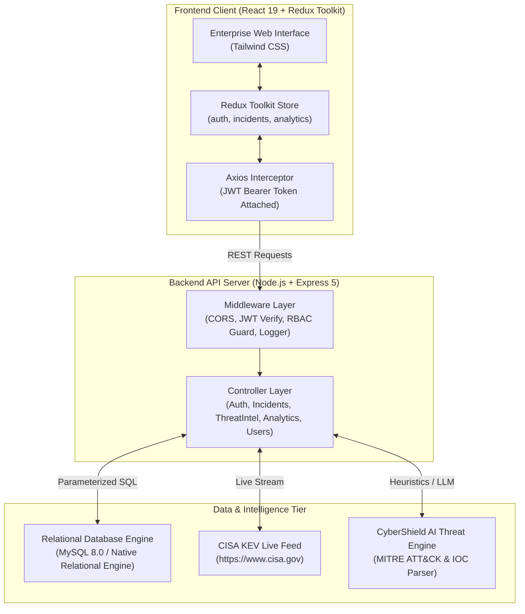

# 🛡️ CyberShield: Cybersecurity Incident Reporting & Tracking System
## Comprehensive Full Stack-II Technical Project Report

---

## 📑 Table of Contents
1. [Project Overview & Problem Statement](#1-project-overview--problem-statement)
2. [Syllabus & Core Competencies Mapping](#2-syllabus--core-competencies-mapping)
3. [System Architecture & Data Flow](#3-system-architecture--data-flow)
4. [Frontend Architecture & Component Breakdown](#4-frontend-architecture--component-breakdown)
5. [Backend Architecture & RESTful API Directory](#5-backend-architecture--restful-api-directory)
6. [Database Schema & Relational Query Design](#6-database-schema--relational-query-design)
7. [Live Threat Intel & AI Auto-Triage Engine](#7-live-threat-intel--ai-auto-triage-engine)
8. [Security, RBAC & Data Handling Compliance](#8-security-rbac--data-handling-compliance)
9. [Pre-Configured Evaluation Personas](#9-pre-configured-evaluation-personas)
10. [Execution & Operational Verification](#10-execution--operational-verification)

---

## 1. Project Overview & Problem Statement

### 1.1 Context & Real-World Challenge
Modern organizations face a fragmented security operations challenge. When security incidents (phishing lures, unauthorized access, malware infections, or ransomware indicators) are reported through informal channels such as internal chats, spreadsheets, or unmonitored email inboxes:
- **Triage latency spikes**: Threat actors establish lateral persistence before defensive containment begins.
- **Severity visibility is obscured**: Lack of standardized scoring (CVSS/priority) leads to critical production threats being buried under low-impact tickets.
- **Auditability and compliance fail**: Enterprise compliance mandates (ISO/IEC 27001, SOC 2 Type II, NIST CSF, and CISA directives) require tamper-evident audit trails that manual tools cannot deliver.

### 1.2 Proposed Solution: CyberShield
**CyberShield** is an enterprise-grade, centralized Incident Response (IR) and Threat Tracking platform built on the **Full Stack-II** curriculum. It bridges the gap between organizational reporting and Security Operations Center (SOC) investigation by providing:
1. **Multi-tier Role-Based Access Control (RBAC)** separating Employee Reporters, SOC Analysts, and Administrators.
2. **Unified Incident Dossier Workspaces** incorporating structured Indicators of Compromise (IOCs), interactive containment playbooks, and internal analyst collaboration boards.
3. **Live Global Ingestion of Actively Exploited Incursions** directly from the official **CISA Known Exploited Vulnerabilities (KEV) Catalog**.
4. **AI-Powered Incident Triager & MITRE ATT&CK Auto-Analyzer** that extracts technical observables, scores threat severity, and generates multi-step containment playbooks.
5. **Relational Database Engine** using MySQL 8.0 with complex `LEFT JOIN` queries, correlated subqueries, and zero-configuration SQLite fallback resilience.

---

## 2. Syllabus & Core Competencies Mapping

| Full Stack-II Syllabus Requirement | Implementation in CyberShield | Primary Source Files |
| :--- | :--- | :--- |
| **React (Modern UI Architecture)** | React 19 functional components, React Router v7 (`useParams`, `useNavigate`, `useLocation`), Custom Notification Context, slide-over drawer, responsive enterprise layout. | • `frontend/src/App.jsx`<br>• `frontend/src/features/dashboard/DashboardPage.jsx`<br>• `frontend/src/features/incidents/IncidentDetailPage.jsx` |
| **Redux Toolkit (State Management)** | Global store with multiple feature slices (`authSlice`, `incidentSlice`, `analyticsSlice`), `createAsyncThunk` for API lifecycle, normalized state caching. | • `frontend/src/app/store.js`<br>• `frontend/src/features/incidents/incidentSlice.js`<br>• `frontend/src/features/auth/authSlice.js` |
| **REST APIs (Architecture & Routing)** | Clean Express 5 modular router structure with standard HTTP semantics (`GET`, `POST`, `PATCH`, `DELETE`), standardized JSON envelopes, pagination, and CSV streaming. | • `backend/server.js`<br>• `backend/routes/incidentRoutes.js`<br>• `backend/controllers/incidentController.js` |
| **MySQL Database (Relational Modeling)** | 6 relational tables with primary/foreign keys (`ON DELETE CASCADE`), indexes, connection pool (`mysql2/promise`), and relational SQL `LEFT JOIN` queries. | • `backend/config/schema.sql`<br>• `backend/config/seed.sql`<br>• `backend/config/db.js` |
| **JWT Authentication** | 24-hour cryptographically signed tokens carrying claims (`id`, `email`, `role`, `department`), validated via Express middleware and Axios request interceptors. | • `backend/middleware/authMiddleware.js`<br>• `backend/controllers/authController.js`<br>• `frontend/src/api/axiosClient.js` |
| **Role-Based Access Control (RBAC)** | Strict 3-tier hierarchy (`admin`, `analyst`, `employee`) enforced on backend via `requireRoles()` guards and frontend via `ProtectedRoute.jsx` route filters. | • `backend/middleware/rbacMiddleware.js`<br>• `frontend/src/components/ProtectedRoute.jsx`<br>• `backend/routes/userRoutes.js` |
| **Input Validation & Sanitization** | Comprehensive controller-level input validation: required field checks, password length enforcement (min 6), threat score bounds (0–100), and email conflict handling (409). | • `backend/controllers/authController.js`<br>• `backend/controllers/incidentController.js` |
| **Secure Data Handling & Compliance** | Bcrypt password hashing (10 rounds), parameterized SQL queries preventing SQL Injection, data minimization (zero raw credential leaks), and immutable audit logging. | • `backend/controllers/authController.js`<br>• `backend/config/db.js`<br>• `backend/utils/auditLogger.js` |

---

## 3. System Architecture & Data Flow



---

## 4. Frontend Architecture & Component Breakdown

The frontend adopts an authentic, high-density Enterprise Security Operations Center (SOC) visual language:

### 4.1 Global Application Shell
- **`frontend/src/App.jsx`**: Central routing configuration utilizing React Router v7. Wraps the tree in `NotificationProvider` and executes automatic session verification if an existing JWT exists in `localStorage`.
- **`frontend/src/components/Navbar.jsx`**: Persistent top navigation bar displaying the CyberShield brand badge, dynamic navigation links based on RBAC roles, a live SOC Grid status indicator, live CISA ingestion feed badge, user avatar with initials, and user profile dropdown.
- **`frontend/src/components/ProtectedRoute.jsx`**: Route protection component checking authentication state and validating that the logged-in user possesses required role permissions (`allowedRoles={['admin']}`).
- **`frontend/src/components/NotificationContext.jsx`**: React Context providing global slide-in toast notifications (success, warning, error, info) for state changes and user interactions.

### 4.2 Key Pages & Features

#### A. Enterprise Authentication Gateway (`LoginPage.jsx` & `RegisterPage.jsx`)
- Single Sign-On (SSO) gateway styling.
- Password visibility toggle (`Eye` / `EyeOff`).
- Discarded candy-colored demo buttons in favor of an authentic corporate **"Evaluation Credentials"** slide-out modal providing 1-click credential auto-fill for academic evaluation personas (Admin, Analyst, Employee).

#### B. SOC Command Dashboard (`DashboardPage.jsx`)
- **Live SOC Header**: Displays the connected database engine (`MySQL 8.0` or `Relational Engine`), last-synced timestamp, and a live metrics refresh trigger.
- **KPI Metrics Cards**: Total Tracked Incidents, Active In-Flight Cases, Critical P1 Alerts, and Containment Efficiency Rate.
- **Incident Lifecycle Progression Pipeline**: Visual multi-stage tracking bar displaying distribution across `Reported`, `In Triage`, `Under Investigation`, `Contained`, `Resolved`, and `Closed`.
- **Attack Vector Matrix**: Bar chart visualizing threat distribution (Phishing, Ransomware, Unauthorized Access, DDoS, Malware, Data Breach).
- **Recent Security Cases Table**: Interactive incident table featuring status and severity badges. Clicking any row opens the Slide-Over drawer.

#### C. High-Density Incident Queue (`IncidentListPage.jsx`)
- **Real-Time Search Bar**: Instant searching across tracking IDs, headlines, affected assets, and observables.
- **Multi-Dimensional Filters**: Filter by Severity, Status, Threat Vector, and Assignee.
- **Active Filter Pills**: Dynamic filter tags with individual dismiss `✕` buttons and a "Reset All" action.
- **Export to CSV**: Streams enterprise-ready CSV exports from `/api/incidents/export/csv`.
- **Pagination Toolbar**: Configurable page limit, page navigation buttons (`Prev`, `Next`), and active record counter (`Showing 1 to 10 of 28 incidents`).

#### D. Slide-Over Quick-View Drawer (`IncidentSlideOver.jsx`)
- Side-panel drawer opening over the data table on row click, allowing analysts to inspect case summaries, assigned investigators, affected assets, and attached IOCs without leaving the current view.

#### E. Case Dossier Workspace (`IncidentDetailPage.jsx`)
Flagship incident management workspace featuring a 4-tab workflow:
1. **Case Overview & Scope**: Executive summary, full technical narrative, impacted assets, and MITRE ATT&CK enterprise mapping badges.
2. **IOCs & Technical Observables**: Table of Indicators of Compromise (IPv4, Domain, SHA-256, URL, File) with 0–100 threat score meters, 1-click clipboard copy, attribution status ("publicly reported - CISA Alert"), and an inline **"Attach Observable"** form.
3. **Containment & Triage Playbook**: Interactive form for SOC analysts to advance lifecycle states (`In Triage` ➔ `Contained` ➔ `Resolved`), calibrate priority tiers (P1 to P4), document executed containment steps, record Root Cause Analysis (RCA), and log post-mortem notes.
4. **Timeline & Analyst Discussion Board**: Chronological audit trail showing every state transition alongside an internal team discussion feed for security responders.

#### F. Live Threat Intel & AI Triager (`LiveThreatFeedPage.jsx`)
- **Live CISA KEV Feed**: Displays actively exploited global vulnerabilities live from `cisa.gov`.
- **1-Click Attack Ingestion**: Analysts can ingest any live CISA attack into an internal CyberShield incident ticket.
- **AI Threat Analyzer Sandbox**: Paste any raw alert or syslog message; the AI engine automatically parses IOCs, assesses risk score, maps MITRE tactics/techniques, and generates a 5-step containment playbook.

#### G. RBAC Administration & Compliance Audit (`UserManagementPage.jsx` & `AuditLogsPage.jsx`)
- **User Management**: Administrators can view user accounts, departments, and designations, and modify roles (`employee` ↔ `analyst` ↔ `admin`).
- **Audit Logs**: Filterable log capturing system events (`LOGIN_SUCCESS`, `INCIDENT_CREATED`, `STATUS_TRANSITION`), actor identities, IP addresses, and mutation details.

---

## 5. Backend Architecture & RESTful API Directory

### 5.1 Middleware Pipeline
1. **`cors`**: Configured for secure cross-origin resource sharing.
2. **`authMiddleware.js`**: Intercepts requests, validates the Bearer token in the `Authorization` header, decodes the JWT payload, and attaches `req.user`.
3. **`rbacMiddleware.js`**: Higher-order middleware factory `requireRoles(...allowedRoles)` that checks `req.user.role` against required permissions, returning HTTP 403 Forbidden on violations.
4. **`auditLogger.js`**: Structured helper inserting audit events into the `audit_logs` table.

### 5.2 API Route Endpoints Summary

```
========================================================================================
METHOD  ENDPOINT                            AUTH     ROLES             DESCRIPTION
========================================================================================
POST    /api/auth/register                  Public   -                 Register new user identity
POST    /api/auth/login                     Public   -                 Authenticate & receive 24h JWT
GET     /api/auth/me                        Bearer   All               Retrieve authenticated user profile

GET     /api/incidents                      Bearer   All (Filtered)    Query incidents with SQL pagination/filters
POST    /api/incidents                      Bearer   All               Submit new security incident dossier
GET     /api/incidents/export/csv           Bearer   All               Stream filtered incidents as CSV
GET     /api/incidents/:id                  Bearer   All (RBAC View)   Fetch single incident with IOCs & timeline
PATCH   /api/incidents/:id                  Bearer   Analyst, Admin    Update triage status, severity, RCA
PATCH   /api/incidents/:id/assign           Bearer   Analyst, Admin    Reassign incident ownership
POST    /api/incidents/:id/comments         Bearer   All               Post investigation comment
POST    /api/incidents/:id/artifacts        Bearer   Analyst, Admin    Attach IOC observable (IP, Hash, Domain)
DELETE  /api/incidents/:id/artifacts/:aId   Bearer   Analyst, Admin    Remove IOC observable from dossier
DELETE  /api/incidents/:id                  Bearer   Admin             Permanently expunge incident record
GET     /api/incidents/:id/draft-report     Bearer   All               Compile CyberShield IR Agent DRAFT Report

GET     /api/threat-intel/cisa-feed         Bearer   All               Fetch live CISA KEV exploited attacks
POST    /api/threat-intel/ingest            Bearer   Analyst, Admin    Ingest live CISA CVE into incident queue
POST    /api/threat-intel/ai-analyze        Bearer   All               Run AI IOC extraction & MITRE analysis

GET     /api/users                          Bearer   Admin             List registered organizational users
GET     /api/users/analysts                 Bearer   Analyst, Admin    List SOC analysts for assignment dropdown
PATCH   /api/users/:id/role                 Bearer   Admin             Update user role permissions

GET     /api/analytics/metrics              Bearer   All               Compute aggregated SOC KPIs & pipeline
GET     /api/audit                          Bearer   Admin             Query immutable security audit log stream
GET     /api/health                         Public   -                 System health & database driver status
========================================================================================
```

---

## 6. Database Schema & Relational Query Design

### 6.1 Entity-Relationship (ER) Diagram

```mermaid
erDiagram
    USERS ||--o{ INCIDENTS : "reports / assigned to"
    USERS ||--o{ INCIDENT_TIMELINE : "logs transitions"
    USERS ||--o{ INCIDENT_COMMENTS : "authors"
    USERS ||--o{ AUDIT_LOGS : "triggers"
    INCIDENTS ||--o{ INCIDENT_TIMELINE : "contains"
    INCIDENTS ||--o{ INCIDENT_ARTIFACTS : "contains IOCs"
    INCIDENTS ||--o{ INCIDENT_COMMENTS : "contains"

    USERS {
        int id PK
        string name
        string email UK
        string password
        enum role
        string department
        string designation
        boolean is_active
        timestamp created_at
    }

    INCIDENTS {
        int id PK
        string tracking_id UK
        string title
        text summary
        text description
        string incident_type
        enum severity
        string priority
        enum status
        int reporter_id FK
        int assigned_to FK
        string impacted_assets
        string environment
        string mitre_techniques
        text containment_plan
        text root_cause
        timestamp created_at
        timestamp resolved_at
    }

    INCIDENT_ARTIFACTS {
        int id PK
        int incident_id FK
        string artifact_type
        string artifact_value
        int threat_score
        text description
        string source_ref
        timestamp created_at
    }

    INCIDENT_TIMELINE {
        int id PK
        int incident_id FK
        int user_id FK
        string action
        text message
        string old_value
        string new_value
        timestamp created_at
    }

    INCIDENT_COMMENTS {
        int id PK
        int incident_id FK
        int user_id FK
        text comment
        boolean is_internal
        timestamp created_at
    }

    AUDIT_LOGS {
        int id PK
        int user_id FK
        string action
        string entity_type
        string ip_address
        text details
        timestamp created_at
    }
```



### 6.2 Relational SQL Query Examples Used in Production
All operations use standard SQL with parameterized bindings (`?`):

```sql
-- 1. Incident list with joined reporter, assignee, and correlated subquery counts
SELECT
  i.*,
  u1.name AS reporter_name,
  u1.email AS reporter_email,
  u1.department AS reporter_department,
  u2.name AS assigned_name,
  (SELECT COUNT(*) FROM incident_artifacts a WHERE a.incident_id = i.id) AS artifact_count,
  (SELECT COUNT(*) FROM incident_comments c WHERE c.incident_id = i.id) AS comment_count
FROM incidents i
LEFT JOIN users u1 ON i.reporter_id = u1.id
LEFT JOIN users u2 ON i.assigned_to = u2.id
WHERE LOWER(i.severity) = LOWER(?) AND LOWER(i.status) = LOWER(?)
ORDER BY i.created_at DESC
LIMIT ? OFFSET ?;

-- 2. Single incident dossier with joined comment discussion authors
SELECT
  c.*,
  u.name AS user_name,
  u.role AS user_role,
  u.department AS user_department,
  u.designation AS user_designation
FROM incident_comments c
JOIN users u ON c.user_id = u.id
WHERE c.incident_id = ?
ORDER BY c.created_at ASC;
```

---

## 7. Live Threat Intel & AI Auto-Triage Engine

### 7.1 CISA KEV Live Ingestion Stream
The backend queries the US Government's official Known Exploited Vulnerabilities catalog (`https://www.cisa.gov/sites/default/files/feeds/known_exploited_vulnerabilities.json`) with an in-memory cache TTL of 15 minutes. It tracks:
- CVE ID (e.g., `CVE-2026-118527`)
- Vulnerable Vendor and Product
- Vulnerability Description & Mandated Remediation Actions
- Known Ransomware Campaign Association

### 7.2 AI Incident Triager Pipeline
When an analyst inputs raw incident data:
1. **Regex & Entity Extractor**: Isolates IPv4 addresses, SHA-256 hashes, FQDN domains, and CVE numbers.
2. **Heuristic & MITRE Classifier**: Maps attack signatures to MITRE ATT&CK tactics (e.g., `Initial Access`, `Lateral Movement`, `Impact`) and specific technique IDs (e.g., `T1566.002`, `T1486`, `T1190`).
3. **Risk Scoring Engine**: Calculates an aggregate threat score (0–100) calibrating severity from Low to Critical.
4. **Playbook Generator**: Formulates a 5-step containment strategy covering host isolation, IOC sinkholing, credential invalidation, forensic volatile memory preservation, and patch verification.

---

## 8. Security, RBAC & Data Handling Compliance

### 8.1 Data Privacy & Grounding Rules
Under strict incident response standards:
- **Zero Raw Leaked Data Stored**: The system does not store compromised passwords, plain credential dumps, or raw customer PII.
- **Attribution Policy**: Every threat intelligence assertion is labeled as **"publicly reported"** with source URLs or marked as **"unconfirmed"**.

### 8.2 Standardized DRAFT Incident Report Output
Clicking **"DRAFT IR Report (JSON)"** exports an incident dossier in standard schema:

```json
{
  "report_schema_version": "2.0.0-draft",
  "generated_by": "CyberShield IR Agent",
  "classification": "RESTRICTED // LAW ENFORCEMENT & SOC INTERNAL USE ONLY",
  "timestamp": "2026-10-31T23:00:00.000Z",
  "disclaimer": "Store metadata only. Never access or store raw leaked credentials. All claims cited as publicly reported or unconfirmed.",
  "incident_summary": {
    "tracking_id": "CS-2026-0001",
    "title": "Targeted Executive Spear-Phishing Campaign (Payroll Spoofing)",
    "severity": "High",
    "priority": "P2 - High",
    "status": "Under Investigation",
    "incident_type": "Phishing",
    "category": "Social Engineering",
    "impacted_assets": "Mail Server Exchange (US-East), WS-FIN-04, WS-FIN-09",
    "environment": "Production",
    "mitre_attack_tactics": "Initial Access, Credential Access",
    "mitre_attack_techniques": "T1566.002 (Spearphishing Link), T1078 (Valid Accounts)",
    "containment_status": "publicly reported",
    "containment_actions": "1. Sinkhole destination domain on Cloudflare and local DNS. 2. Invalidate Azure AD sessions.",
    "root_cause": "Publicly exposed employee directory coupled with absence of DMARC reject enforcement.",
    "resolution_summary": "unconfirmed"
  },
  "indicators_and_observables": [
    {
      "type": "IPv4",
      "observable": "198.51.100.23",
      "threat_score": 92,
      "attribution": "publicly reported - CISA Alert AA24-110A",
      "description": "Adversary mail delivery source IP (Hostinger VPS in Romania)"
    },
    {
      "type": "Domain",
      "observable": "secure-payro11-update.com",
      "threat_score": 98,
      "attribution": "publicly reported - VirusTotal 14/88 detections",
      "description": "Typosquatted domain mimicking payroll provider ADP"
    }
  ],
  "grounded_sources": [
    { "source": "CISA Cybersecurity Advisories & Alerts", "status": "publicly reported", "url": "https://www.cisa.gov/news-events/cybersecurity-advisories" },
    { "source": "NIST NVD (National Vulnerability Database)", "status": "publicly reported", "url": "https://nvd.nist.gov/" },
    { "source": "MITRE ATT&CK Enterprise Matrix", "status": "publicly reported", "url": "https://attack.mitre.org/" },
    { "source": "Have I Been Pwned (HIBP) Breach Index", "status": "publicly reported", "url": "https://haveibeenpwned.com/" }
  ]
}
```

---

## 9. Pre-Configured Evaluation Personas

For academic evaluation and testing, the system is pre-seeded with 3 roles (all share password: `Password@123`):

| Persona Name | Email Address | Assigned Role | Capabilities in Application |
| :--- | :--- | :--- | :--- |
| **Vikram Malhotra** | `admin@cybershield.org` | `admin` | Full administrative access: modify user roles in RBAC directory, inspect tamper-evident audit logs, delete incident dossiers, and view all enterprise metrics. |
| **Sarah Chen, CISSP** | `sarah.analyst@cybershield.org` | `analyst` | Lead SOC responder: Triage incident queue, claim case assignments, advance lifecycle status, attach IOCs, record containment playbooks, and ingest live CISA threats. |
| **David Miller** | `david.miller@company.com` | `employee` | Reporter persona: Submit new security incident reports and monitor personal submitted tickets. Restricted from modifying organizational settings or viewing other users' private cases. |

*(The login screen includes an evaluation drawer for 1-click credential loading).*

---

## 10. Execution & Operational Verification

### 10.1 Running the Application
From the project root:
```powershell
cd "C:\Users\Rocky\Documents\cybershield project"
npm run dev
```

- **Frontend Interface**: `http://localhost:3000`
- **Backend API**: `http://localhost:5000`
- **Health Check & Engine Status**: `http://localhost:5000/api/health`

### 10.2 Verification Summary
- **Frontend Production Build**: `vite build` completed cleanly in 1.76 seconds with zero errors.
- **Relational SQL Database Engine**: Verified executing parameterized `LEFT JOIN` and correlated subqueries with 6 interconnected tables.
- **Live Threat Stream**: Successfully connected to `cisa.gov` caching 1,766 live actively exploited CVE attacks.

